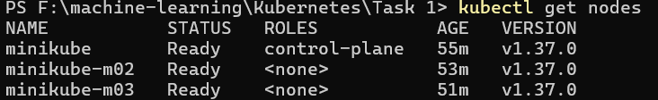
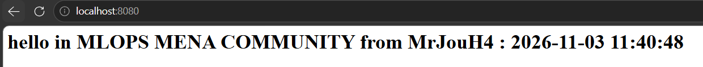
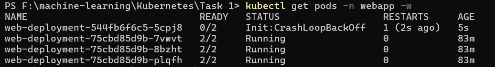
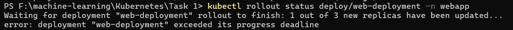
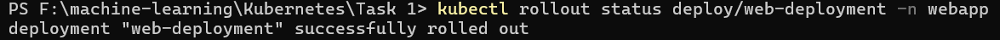

# Task 1: Kubernetes Deployment & Shared Process Namespace

## Overview
This task demonstrates setting up a 3-node Minikube cluster using Calico CNI, deploying a multi-container Pod sharing process namespaces (`shareProcessNamespace: true`), simulating a failing init container, and observing Kubernetes RollingUpdate behavior.

---

## 1. Cluster & Namespace Setup
Created a 3-node Minikube cluster with Calico CNI and created the `webapp` namespace:
```bash
minikube start --nodes 3 --cni=calico --cpus 2 --memory 2200
kubectl create namespace webapp
```


## 2. Deployment Setup
Created `deployment.yaml` containing:
- 3 replicas in webapp namespace.
- shareProcessNamespace: true.
- Init container init-done (busybox:1.36).
- Main container nginx (nginx:1.27) serving custom HTML.
- Sidecar container time-updater (busybox:1.36) with SYS_PTRACE capability updating /proc/$PID/root/usr/share/nginx/html/index.html every 5 seconds.

Applied deployment and verified pods:
```bash
kubectl apply -f deployment.yaml
kubectl port-forward -n webapp deploy/web-deployment 8080:80
```


## 3. Simulating Init Container Failure
Modified `initContainers` command to exit with status 1 (`exit 1`) and re-applied:

```Bash
kubectl apply -f deployment.yaml
```
### Observations & Answers:
- Pod Status: The new replacement Pod displayed Init:CrashLoopBackOff.

- Main Containers Status: nginx and time-updater remained in state Waiting (PodInitializing) and never started, as Kubernetes requires all init containers to exit with code 0 first.

- Availability: http://localhost:8080 remained fully reachable because Kubernetes uses a RollingUpdate strategy. Since the new Pod never became Ready, the 3 original healthy Pods remained active to handle incoming traffic.



## 4. Fixing the Deployment
if you exceeded the time (10 minutes) it returns


Reverted `initContainers` back to echo done (`exit 0`) and re-apply:

```Bash
kubectl apply -f deployment.yaml
kubectl rollout status deploy/web-deployment -n webapp
```
